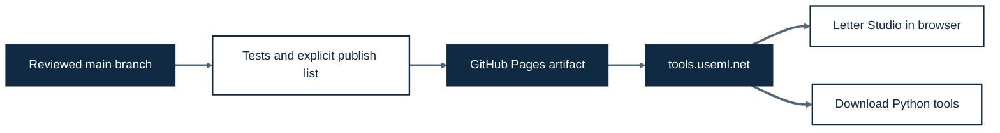

# useml.net tools

Small browser tools and local Python utilities from [useml.net](https://useml.net/),
inspired by [Simon Willison's tools](https://github.com/simonw/tools).
The intended public address is **https://tools.useml.net/**.

## Tools

| Tool | Runs in | Purpose |
| --- | --- | --- |
| [Hungarian Letter Studio](hungarian-letter-studio.html) | Browser | Transcribe letters, generate prompts, evaluate accuracy, tokens and estimated USD cost |
| [Whisper transcription](transcribe.py) | Local Python | Transcribe audio/video with Whisper |
| [Whisply](whisply_script.py) | Local Python | Launch transcription and diarization UI |
| [Media downloader](yt-dlp-script.py) | Local Python | Download video or extract audio |

Letter Studio is one self-contained HTML file: plain JavaScript and CSS, bundled
JSZip, no build step, external scripts, analytics, or backend. See its
[instructions](hungarian-letter-studio.docs.md) for formats, limits and cost semantics.

Run local scripts with [uv](https://docs.astral.sh/uv/):

```sh
uv run transcribe.py recording.m4a
uv run whisply_script.py
uv run yt-dlp-script.py "https://example.com/video"
```

Media decoding and audio extraction may require FFmpeg installed locally.
Use each script's `--help` for options.

## Preview and check

```sh
node --test tests/studio.test.cjs
sh scripts/build-site.sh
python3 -m http.server 8000 --directory _site
```

Visit http://localhost:8000/. The staging script uses an explicit file list and
refuses to overwrite an existing `_site`; move that generated folder aside before
rebuilding. It never publishes recordings, transcripts, `.env`, or the source ZIP.

## Publish to tools.useml.net

The Pages workflow checks pull requests and deploys only `main` after checks pass.
Before merging the publishing PR:

1. In repository **Settings → Pages**, choose **GitHub Actions** as the source.
2. Set the custom domain to `tools.useml.net` in Pages settings. The checked-in
   `CNAME` documents the intended domain; Actions deployments still require this
   setting in GitHub.
3. At your DNS provider, add a **CNAME** for `tools` pointing to
   **swartchris8.github.io** (no path). Leave the blog's apex records alone.
4. Merge the PR and wait for the Pages deployment and certificate. Enable
   **Enforce HTTPS** when GitHub makes it available.

See GitHub's [custom workflow documentation](https://docs.github.com/en/pages/getting-started-with-github-pages/using-custom-workflows-with-github-pages)
and [custom domain instructions](https://docs.github.com/en/pages/configuring-a-custom-domain-for-your-github-pages-site/managing-a-custom-domain-for-your-github-pages-site).



## Adding a tool

Prefer a descriptive root-level `.html` file and matching `.docs.md` instructions.
Link it from `index.html`, add its public assets to `scripts/build-site.sh`, and
include relevant checks. Keep API keys and user files out of git. Third-party
code retains its own license in `licenses/`.
